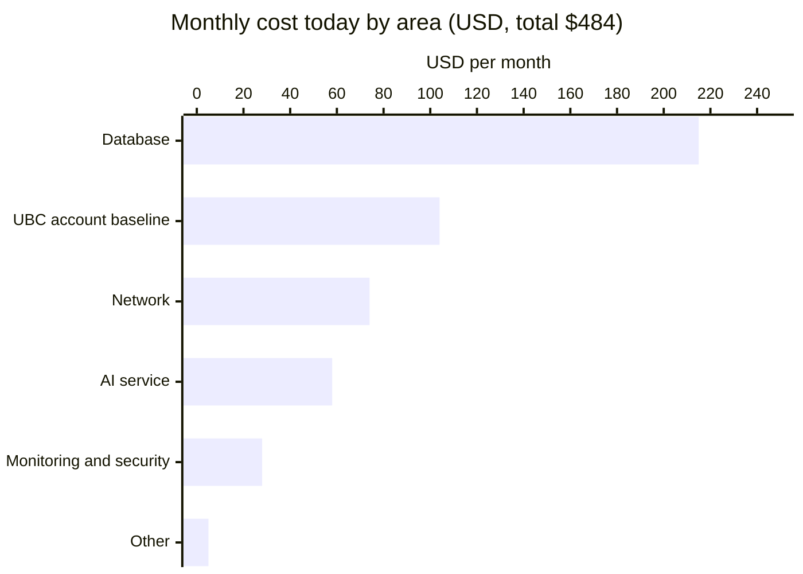
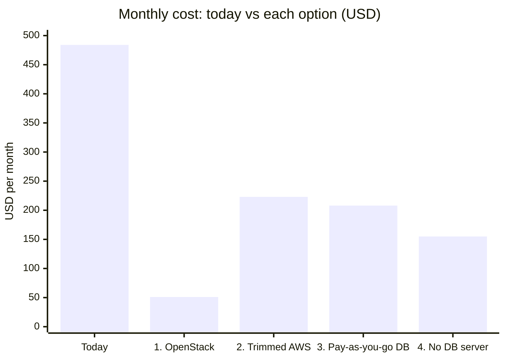

# OCELIA Hosting Options: Decision Brief

*Draft · 2 November 2026 · Based on real usage from 3 September to 1 November 2026*

All costs are in US dollars per month, before tax, unless stated otherwise. AWS adds about 11% tax.

---

## In short

- **OCELIA costs about $484 a month today**, or about $5,800 a year. About 60% of that pays for computing capacity far larger than the app actually uses.
- **Two separate decisions** drive the cost:
  1. **Where the app runs.** We can stay on Amazon Web Services (AWS) or move to a UBC OpenStack server.
  2. **Which AI service answers students.** We can stay on Amazon's AI service, or move to the UBC AI Gateway, which UBC has already approved for privacy and which costs less.
- **Recommendation:** trim the current AWS setup now, which cuts the bill roughly in half within a week. At the same time, apply for the UBC AI Gateway. Then decide whether moving to OpenStack is worth the extra staff time.

| | Monthly | Yearly | Setup work |
|---|---|---|---|
| Today | $484 | ~$5,800 | – |
| After the recommended first steps | ~$223 | ~$2,680 | 3–5 days, then 2–3 weeks for the AI switch |
| Cheapest option (OpenStack) | ~$51 | ~$610 | 5–10 weeks, plus ongoing upkeep |

---

## How OCELIA is used today

| | |
|---|---|
| Registered users | 145 |
| Student chats in October | 3,231 |
| Busiest hour | 99 chats |
| Most chats running at the same time | 3 |
| Course documents uploaded | 84 |

The app is lightly used compared with what it's built to handle.

## Where the money goes today

| Area | $/month | What it is |
|---|---|---|
| Database | 215 | Stores courses, documents and chat records. It's sized and duplicated well beyond the current need |
| UBC account baseline | 104 | Security and compliance services UBC adds to every AWS account. We can't turn these off |
| Network | 74 | Private networking around the database |
| AI service | 58 | The AI that answers students, checks answers and reads documents |
| Monitoring and security | 28 | Alerts, logs and a web firewall |
| Other | 5 | The rest of the app, including all its computing |

**About the UBC baseline.** The AWS account also manages 52 UBC Arts servers that aren't part of OCELIA, and they cause much of this baseline charge. OCELIA may be paying for more than its share. We should ask UBC IT how this cost should be split.

---

## The AI service choice

This choice applies to every hosting option.

| | Amazon's AI service (today) | UBC AI Gateway |
|---|---|---|
| Monthly cost today | $58 | ~$31 |
| Privacy | Student messages are processed in the US. This still needs a privacy check | Already approved through UBC's privacy review. It doesn't store conversations |
| Content safety filter | Built in | We can keep Amazon's filter alongside the gateway for about $3–5 a month |
| To start | Nothing, it's in use | An application, an eligibility review and an agreement with UBC's Learning Technology Innovation Centre (LTIC) |
| Work to switch | – | 2–3 weeks, including testing that answer quality holds up |

**Recommendation:** apply for the UBC AI Gateway now, because approval takes time.

---

## The four hosting options

All prices assume the UBC AI Gateway.

| Option | What it means | Monthly | Yearly | Setup work | Ongoing upkeep |
|---|---|---|---|---|---|
| **1. UBC OpenStack server** | Move everything onto one UBC-run server (UBC EduCloud) | ~$51 | ~$610 | 5–10 weeks | 2–4 hours a week |
| **2. Trimmed AWS** *(recommended now)* | Keep the app as it is, but shrink what's oversized | ~$223 | ~$2,680 | 3–5 days | Low |
| **3. AWS, pay-as-you-go database** | Replace the database with one that charges only while in use | ~$195–220 | ~$2,350–2,650 | 2–4 weeks | Lowest |
| **4. AWS, rebuilt without a database server** | Redesign how data is stored so nothing runs while the app is idle | ~$150–160 | ~$1,800–1,900 | 6–10 weeks | Lowest |

*Ranges are shown at their midpoint.*

### Option 1: UBC OpenStack server
- ✅ By far the cheapest, about 89% less than today. A flat, predictable bill
- ✅ Student data stays at UBC. Uses UBC sign-in (CWL) and UBC services throughout
- ❌ The most work to move, and our team takes over maintenance, backups and security that AWS and UBC handle today
- ❌ A single server, so any fault or maintenance means downtime. A standby server for about CAD $185 a year would allow recovery within minutes
- ❌ Students would sign in with CWL instead of their current OCELIA accounts

#### The OpenStack server (UBC EduCloud)

UBC IT's EduCloud Server Service charges a yearly fee in Canadian dollars for each server, plus amounts for its processors (vCPU), memory (RAM) and storage (disk). The sizes below are based on how much memory and processing OCELIA actually used over the last 30 days. Memory is the main cost, and OCELIA's busiest moments, when documents are uploaded, need about 6–7 GB.

**Sizing at FY26/27 rates (CAD per year)**

| | vCPU | RAM | Disk | CAD/yr | USD/mo* | Fits |
|---|---|---|---|---|---|---|
| Lean | 2 | 8 GB | 80 GB | $224 | ~$13 | Today's load, but tight while documents are processed |
| **Recommended** | **4** | **12 GB** | **100 GB** | **$297** | **~$18** | Today's load, with room to grow about 10× |
| Growth | 4 | 16 GB | 150 GB | $353 | ~$21 | 10× usage, with more memory for speed |
| Optional standby VM | 2 | 4 GB | 100 GB | +$185 | +~$11 | Keeps a live copy of the data and backups, for recovery in minutes |

*At USD 0.72 per CAD. Update with the current exchange rate.

**EduCloud rates rise about 15% a year.** The recommended server goes from CAD $297 (FY26/27) to $347 (FY27/28), then $399 (FY28/29), then $454 (FY29/30). That is still about USD $27 a month by FY29/30.

**Option 1's monthly cost with the recommended server:**

| | USD/month |
|---|---|
| Server | ~$18 |
| Off-server backups | ~$2 |
| UBC AI Gateway | ~$31 |
| **Total** | **~$51** |
| With the optional standby VM | ~$60 |

### Option 2: Trimmed AWS (recommended first step)
- ✅ Halves the bill in under a week, with no change for students or instructors
- ✅ Low risk and easy to undo
- ❌ The most expensive of the four options over time
- ❌ The $104 UBC baseline stays

### Option 3: AWS with a pay-as-you-go database
- ✅ Costs drop during term breaks, and there's very little to maintain
- ❌ Only about $25 a month cheaper than Option 2, for 2–4 weeks of work
- ❌ Costs are less predictable when the app is busy

### Option 4: AWS rebuilt without a database server
- ✅ The cheapest AWS option, and it handles growth best with nothing to resize
- ❌ About the same effort as moving to OpenStack, which saves more
- ❌ Ties the app most closely to Amazon, which makes a future move harder

---

## OpenStack or AWS: the core trade-off

| | UBC OpenStack | AWS |
|---|---|---|
| **Cost** | Lowest (~$51 a month). Hosting alone is about 7–10× cheaper | Higher (~$150–223 a month) |
| **Staff time** | 2–4 hours a week, more as usage grows | Low. Amazon runs the infrastructure |
| **Reliability** | One server, with downtime during faults or maintenance. A standby server (~CAD $185 a year) allows recovery in minutes | Built-in backup systems and automatic recovery |
| **Growth** | Needs more servers and a redesign | Grows automatically |
| **Security** | Our team is responsible | UBC's security monitoring is included |
| **Where data lives** | At UBC | In Amazon's Canadian data centre (and the US for AI calls, unless we use the UBC gateway) |
| **Flexibility later** | Standard tools that can move anywhere | Harder to move away from |
| **Effort to switch** | 5–10 weeks | Option 2 takes days |

### Growing with demand

**On AWS, most of the app grows by itself.**

- The parts that answer students start extra copies automatically, within seconds, for each chat that arrives. Going from 3 chats at once to 300 needs no change from the team.
- The bill follows actual use. A quiet summer costs less than exam week.
- Where something does need to grow, such as the database in Option 2, it's a setting change that takes minutes, with a short restart. Options 3 and 4 grow even the data storage automatically.
- Everything runs across several Amazon data centres in the region, so extra capacity is always available.

**On OpenStack, growth is planned and done by hand.**

- The server has a fixed size, and we pay for that size whether it's used or not.
- To grow, we submit a request to UBC IT for more processors, memory or storage, then restart the server.
- A sudden spike, such as exam week, can slow the app if the server is already full, so capacity has to be added ahead of time.
- One server has a ceiling. Beyond it, roughly past 10× today's usage, the app has to be split across several servers with a load balancer in front. That redesign takes weeks.

At today's usage, the recommended server has plenty of spare room, so this matters mostly if OCELIA grows.

### Who looks after what

EduCloud is a self-managed service. UBC IT provides the hardware and network, and our team is responsible for everything running on the server. On AWS, Amazon takes care of most of the layers underneath the app.

| Task | OpenStack (EduCloud) | AWS |
|---|---|---|
| Physical hardware, power, data centre | UBC IT | Amazon |
| Replacing failed hardware | UBC IT, after which our team restores and restarts the app | Amazon, automatically. The app keeps running in another data centre |
| Operating system security patches | **Our team**: regular updates and restarts | **Amazon.** The app's computing has no operating system for us to manage. Option 2 keeps one small network server that we patch |
| Database updates and security fixes | **Our team**: installing, upgrading and tuning | **Amazon** applies them in a scheduled maintenance window |
| Database backups | **Our team** sets them up, stores them off the server and tests restoring them | **Amazon**: automatic daily backups, with restore to any point in the last 7 days |
| Web security certificates | **Our team** sets up automatic renewal and watches it | **Amazon** renews them automatically |
| Protection from attacks and abuse | **Our team**: firewall rules and rate limiting | **Amazon** includes basic attack protection, and a web firewall is already in place |
| Security monitoring and compliance checks | **Our team** sets up logging and alerts | **Included** through UBC's AWS account baseline |
| Keeping the app's own code and libraries up to date | Our team | Our team |

The last row is the same on both platforms. The rows above it are the work that moves to our team on OpenStack. That's the main source of the 2–4 hours a week of upkeep, and of the on-call duty if OCELIA grows.

**Choose OpenStack if** staff time is available or already budgeted, running on UBC services is a goal in itself, and short outages during maintenance are acceptable.

**Choose AWS if** staff time is scarce, reliability during term matters, or growth is expected or uncertain.

---

## If usage grows

Monthly cost, using the UBC AI Gateway:

| Option | Today (145 users) | 10× (~1,450 users) | 100× (~14,500 users) |
|---|---|---|---|
| 1. OpenStack | ~$51 | ~$335–375 | ~$3,250 |
| 2. Trimmed AWS | ~$223 | ~$610–635 | ~$4,150–4,650 |
| 3. Pay-as-you-go database | ~$195–220 | ~$595–620 | ~$4,100–4,550 |
| 4. No database server | ~$150–160 | ~$490–515 | ~$3,800–4,150 |

**What changes as OCELIA grows:**

- **The AI service becomes most of the bill.** At 100× usage it is roughly $3,100–3,500 of every option's total. By then the hosting choice matters much less than the choice of AI service and AI model.
- **The AI bill can be cut a lot.** Reusing repeated parts of each AI request ("prompt caching") could save about $900 a month at 100×. UBC's own AI models could cost under $100 a month, if they give good enough answers.
- **OpenStack stops being one simple server.** At 100× it needs about 6 servers (around CAD $2,100 a year) and someone on call during term, so the staff time may cost more than the money saved.
- **Option 4 grows with the least effort.** Options 2 and 3 need some resizing.
- **Budget:** at 100× usage the AI service alone costs about $3,000 or more a month, whichever option is chosen. Funding needs planning early.
- **Capacity limits:** we'd need to raise some limits on the AWS side in advance, and confirm with LTIC that the UBC AI Gateway can handle the volume.

---

## Recommended path

1. **Now: trim AWS and apply for the UBC AI Gateway.** 3–5 days of work brings the bill to about $248 a month.
2. **Once approved: switch to the UBC AI Gateway.** 2–3 weeks of work brings it to about $223 a month, and student messages stay within a UBC-approved service.
3. **Then: decide on OpenStack.** Moving saves about another $2,000 a year, set against 5–10 weeks of work and ongoing upkeep. If OCELIA must stay on AWS and growth is expected, Option 4 is the alternative for similar effort.

---

## Questions to answer before deciding

| Question | Who can answer |
|---|---|
| Is OCELIA eligible for the UBC AI Gateway, and how long does approval take? | LTIC |
| Who pays for AI usage, and can the gateway handle growth? | LTIC |
| Can an EduCloud server be reached by students from off campus (public address, firewall, web certificate)? | UBC IT |
| Does EduCloud's UBC backup service cost extra, and what uptime and support hours does it offer? | UBC IT |
| Does EduCloud's privacy (FIPPA) support cover OCELIA's student data? | UBC IT and UBC Privacy |
| How much downtime is acceptable during term? | Project leads |
| How much staff time can go to migration and upkeep? | Project leads |
| How should the shared AWS account's baseline cost be split with Arts IT? | UBC Hybrid Cloud and Arts IT |
| How much growth do we expect in the next 12 months? | Project leads |

---

## Notes on the figures

- Usage and costs come from the production AWS account's billing and monitoring data for September and October 2026.
- UBC AI Gateway costs use LTIC's published prices with October's usage.
- Growth figures assume chats grow in line with users. The 100× figures are estimates that would need testing.
- OpenStack server prices are UBC EduCloud's published yearly rates for FY26/27, in CAD (it.ubc.ca, EduCloud Server Service). They're converted at USD 0.72 per CAD. Server sizes come from 30 days of production memory and processor use.
- The two months measured were the start of term. Summer usage is likely lower.
